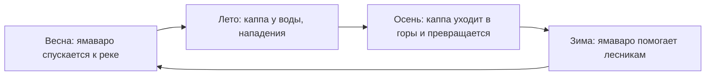
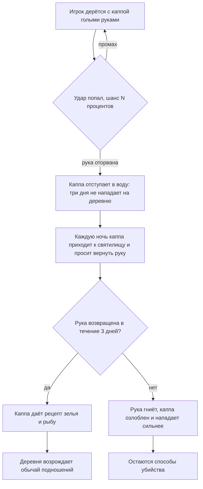

# Мод о мифических созданиях: Каппа и Ямаваро

Дизайн-документ существа, которое летом живёт у воды как каппа, а зимой в горах как ямаваро.

## Содержание

1. [Идея](#идея)
2. [Скрытый лор](#скрытый-лор)
3. [Мир: долина, горы и сезоны](#мир-долина-горы-и-сезоны)
4. [Каппа: облик и вода во впадине](#каппа-облик-и-вода-во-впадине)
5. [Каппа: поведение, захват и спасение](#каппа-поведение-захват-и-спасение)
6. [Способы справиться с каппой](#способы-справиться-с-каппой)
7. [Путь договора: рука](#путь-договора-рука)
8. [Превращение в ямаваро](#превращение-в-ямаваро)
9. [Ямаваро](#ямаваро)
10. [Баня](#баня)
11. [Расположение: как память переходит между формами](#расположение-как-память-переходит-между-формами)
12. [Расследование](#расследование)
13. [Квест рыбака](#квест-рыбака)
14. [Награды и последствия](#награды-и-последствия)
15. [Новые предметы, блоки и профессии](#новые-предметы-блоки-и-профессии)
16. [Особые случаи](#особые-случаи)

---

## Идея

Одно существо живёт двумя жизнями. Летом оно каппа: хранитель утонувших, опасный и очень вежливый. Зимой оно ямаваро: безобидный лесной шалун, который помогает лесникам за сакэ и онигири. Осенью каппа уходит в горы и превращается, весной возвращается к реке.

- **Каппа не злодей.** Он нападает на деревню у воды потому, что она бросила обычай искупления: носить подношения тем, кому когда-то не помогла.
- **Вежливость — его слабость.** Честное существо погибает от собственной воспитанности, если ею воспользоваться.
- **Убить проще, чем договориться.** Убийство даёт разовую награду и не решает причину, договор даёт постоянную пользу.
- **Память переходит между формами.** Как игрок поступил с каппой летом, так его встретит ямаваро зимой и каппа следующей весной.
- **Причину игрок складывает сам.** Из записей разных людей, которые противоречат друг другу и друг друга дополняют (см. [Расследование](#расследование)).

## Скрытый лор

Давно, в паводок, на дальнем берегу реки тонули несколько семей. Они кричали в сторону деревни. В окнах горели огни, но никто не вышел: лодки не спустили, ворота перевоза не открыли, каждый боялся за себя. К утру все утонули, среди них дети.

Деревня не смогла с этим жить. Над берегом поставили святилище, на плите выбили: «Мы слышали. Мы не пришли. Простите нас», и стали носить утонувшим еду. Хранителем этого места стал дух реки: каппа.

Подношения были искуплением, и каждое новое поколение носило их тяжелее: они напоминали о вине. Деревня стала носить их реже, потом совсем перестала, чтобы не вспоминать. Святилище заросло мхом, а что за ним стоит, забыли все, кроме тех, кто написал об этом когда-то. Староста вычеркнул расход из книги: «Деревня давно рассчиталась. Лучше не напоминать».

Каппа не мстит. Он напоминает: деревня когда-то не пришла на зов тонущих, а теперь забывает об этом. Поэтому он забирает людей из тех же вод, у того же берега.

Зимой река мелеет и скудеет, и хранитель уходит туда, где вода течёт из-под земли: к горным источникам. Там он отдыхает в облике ямаваро. Весной он спускается обратно.

Горные жители помнят обычай и не знают, откуда он: они до сих пор оставляют ямаваро онигири и сакэ. Они не виновны в том, что случилось в долине, и потому им не стыдно помнить.

**Главное правило мира.** Каппа нападает не на всех, а на деревню, бросившую обычай искупления. Вернуть подношение значит вернуть память, а вместе с ней и мир.

## Мир: долина, горы и сезоны

Нужен новый регион из двух частей, которые генерируются рядом друг с другом (примерно в 200–400 блоках одна от другой).

### Речная долина
Низина с озёрами, реками и заболоченными берегами. Рисовые поля, огороды, причалы.

**Деревня у воды.** Живут рыбаки и земледельцы. Рисовые чеки, огород с огурцами, причал, дом рыбака, баня, **заброшенное святилище** на берегу.

### Лесные горы
Невысокие горы, поросшие лесом: без снежных пиков, с хвойными и лиственными деревьями (кедр, клён, берёза). Тропы, ручьи, горные источники.

**Горная деревня.** Живут лесники. Лесопилка, угольная яма, баня у горячего источника, **лесной алтарь** (пень с чашей для подношений), склад брёвен.

### Тропа
Извилистая тропа с каменными фонарями соединяет долину и горы. По ней осенью уходит и весной возвращается каппа.

### Сезоны
Работают **только в этом регионе**. Цикл 32 игровых дня: по 8 дней на сезон. Время считается по игровому дню мира, а не по присутствию игрока.

| Сезон | Долина и горы | Существо |
| --- | --- | --- |
| Весна | Цветение вишни в долине, дожди, посев риса | С 1-го дня ямаваро спускается по тропе, к 3-му дню превращается в каппу. С 3-го дня возможны нападения |
| Лето | Густая зелень, жара, огурцы и конопля растут быстрее | Каппа активен, нападает на деревню у воды |
| Осень | Клёны краснеют, сбор риса, варка сакэ | В первую ночь каппа уходит в горы, к 3-му дню превращается в ямаваро |
| Зима | Лёгкий снег в долине, голые ветви, лесные работы | Ямаваро живёт в горной деревне, помогает лесникам |

**Доска сезонов.** На площади каждой деревни стоит доска, которая показывает сезон и день. Это единственный явный указатель: остальное игрок читает по листве и погоде.

## Каппа: облик и вода во впадине

**Облик.**
- Высота 1 блок. Человекообразный.
- Кожа лягушачья, зелёная и влажная.
- На спине черепаший панцирь (только на спине).
- Вместо носа и рта клюв.
- Между пальцами рук и ног перепонки.
- На голове впадина с водой, по бокам от неё волосы.
- Левое ухо надорвано. Это примета именно этого существа, она одинакова у каппы и у ямаваро.

Вода во впадине должна быть **видна**: её уровень показывает, сколько у каппы сил.

**Вода — его жизнь и подвижность.**

| Состояние | Что происходит |
| --- | --- |
| Вода есть | Каппа активен, быстрый, сильный. В воде восстанавливает впадину мгновенно |
| Вода частично расплёскана | Каппа медленнее, слабее бьёт |
| Воды нет | Каппа неподвижен и медленно умирает (около 3 минут). Смерть можно ускорить |

**Как расплескать воду.**
1. **Поклон.** Каппа кланяется в ответ, и вода выливается целиком.
2. **Удары по голове.** Удар голыми руками или копьём из конопли расплёскивает часть воды.
3. **Вытащить из воды.** На суше впадина сама не пополняется. Пока каппа в воде или идёт дождь, вода возвращается.

**Как ускорить смерть неподвижного каппы.**
- Бить его голыми руками или стеблями конопли (меч не работает).
- Дневное солнце без тени ускоряет высыхание вдвое.

**Как спасти неподвижного каппу.**
- Налить воду во впадину из ведра. Каппа приходит в себя и считает это долгом (см. [Особые случаи](#особые-случаи)).
- Дождь медленно пополняет впадину: если дождь пошёл вовремя, каппа может выжить.

На воде каппа почти неуязвим, поэтому сражаться с ним нужно на берегу.

## Каппа: поведение, захват и спасение

**Где появляется.** Возле водоёмов долины (река, озеро, берег) у деревни с заброшенным святилищем. Только весной (с 3-го дня) и летом.

**Когда.** Ночью и в сумерках.

**Что делает.**
- Ищет цель в радиусе 8 блоков от воды.
- Нападает на жителей и на игрока, хватает и утаскивает под воду.
- Дальше 8 блоков от воды не заходит.

**Характер.** Говорит только вежливыми фразами: «Прошу прощения за беспокойство», «Простите, я должен». Нападение он описывает как необходимость, а не как злость.

### Захват
Каппа хватает цель и тащит под воду. Это не мгновенная смерть: у спасения есть время.

| Цель | Время до смерти | Как спастись |
| --- | --- | --- |
| Житель | 10 секунд | Игрок успевает дать каппе огурец |
| Игрок | 12 секунд | Дать огурец или добить каппу стеблями конопли |

**Огурец.** Если дать каппе огурец (ПКМ по нему), он отпускает цель, съедает огурец и уходит на несколько минут (по умолчанию 5). Повторный огурец подряд срабатывает хуже: каппа уже сыт, и время ухода короче.

**Если игрок не успел.** Житель погибает под водой. Игрок на лёгком и обычном уровне сложности остаётся с 1 сердцем и выброшен на берег, на сложном погибает.

**Важно.** Пока каппа в воде, впадина восстанавливается мгновенно, поэтому расплёскивать воду в захвате бесполезно.

## Способы справиться с каппой

Мечи против каппы не работают совсем: его кожа скользкая, и металл не наносит урона.

| Способ | Как работает | Награда | Смысл |
| --- | --- | --- | --- |
| Договориться | Оторвать руку и вернуть за три дня | Рецепт зелья, рыба, постоянный мир | Лучший исход |
| Поклон | Поклониться каппе на берегу | Панцирь, рыба | Обман: честное существо погибает от вежливости |
| Борьба | Накормить подношением усопшим, затем биться голыми руками | Панцирь, рыба | Честный поединок |
| Стебли конопли | Бить заточенными стеблями или копьём из них | Панцирь, рыба | Прямое убийство |

### Поклон
Работает только при выполнении условий, иначе это слишком дешёвый способ:
- каппа на суше (не в воде);
- игрок не бил его в последнюю минуту (вежливый каппа не ответит нападающему);
- каппа сейчас не держит цель в захвате;
- каппа не в пути (в дороге он не кланяется: боится расплескать воду).

Игрок использует кнопку «Поклон» на расстоянии не больше 3 блоков. Каппа кланяется в ответ, вода выливается, он замирает и умирает за три минуты. Игрок может ускорить смерть или передумать и налить воду обратно.

### Борьба голыми руками
Голые руки наносят каппе мало урона: кожа скользкая. Но есть два исключения:
- **Подношение усопшим.** Если дать каппе подношение (ПКМ), он принимает его и вызывает игрока на борьбу в духе сумо. С этого момента урон голыми руками по нему становится нормальным, а сам он не использует захват.
- **Оторванная рука.** Каждый удар голыми руками по каппе, у которого есть вода во впадине, даёт шанс N% (по умолчанию 15%) оторвать ему руку. Это отдельный путь (см. следующий раздел).

### Стебли конопли
Заточенные стебли и копьё из них пробивают скользкую кожу и наносят полный урон. Работают даже в воде, но там каппа сильнее всего.

## Путь договора: рука

**Что происходит после отрыва руки.**
1. Каппа уходит в воду. Три игровых дня он не нападает на деревню.
2. Игрок получает предмет **«Рука каппы»**. Он портится за три дня (в описании видно, как рука темнеет).
3. Каждую ночь каппа приходит к святилищу и просит вернуть руку. Сообщения в чате, звуки у воды. Он вежливо говорит: «Верните, пожалуйста. Я не в обиде».
4. Игрок отдаёт руку (ПКМ по каппе с рукой в руках).

**Если рука возвращена.**
- Каппа прикрепляет руку и вручает рецепт зелья усиленной регенерации (предмет «Записка каппы»).
- Перестаёт нападать на деревню.
- Каждое утро оставляет рыбу у святилища.
- Просит принести подношение к святилищу. Игрок кладёт его, святилище становится ухоженным, а жители возрождают обычай и дальше носят подношения сами.

**Если рука не возвращена.** Рука гниёт, каппа озлоблен: сильнее бьёт, нападает чаще. Остаются способы убийства.

**Если игрок умер, не вернув руку.** Рука выпадает с вещами. Три дня идут по игровому времени.

**Если на эти три дня выпадает смена сезона.** Каппа не уходит в горы, пока не истекут три дня или не вернут руку.

## Превращение в ямаваро

**Осень: каппа → ямаваро.**
1. **Накануне.** В первую ночь осени каппа перестаёт нападать, кладёт на впадину лист и выходит из воды. На берегу остаются влажные следы, ведущие к тропе.
2. **Дорога.** Два игровых дня он идёт по тропе к горам. В пути он миролюбив, но не кланяется в ответ и защищается, если на него нападут.
3. **Источник.** На горном источнике, возле деревни лесников, ночью он превращается: панцирь трескается и осыпается мхом, впадина высыхает, по телу прорастает красно-бурая шерсть. Он встаёт на ноги: теперь это ямаваро.

**Весна: ямаваро → каппа.** Всё в обратном порядке. В первый день весны он спускается по тропе. У реки на спине вырастает панцирь, впадина наполняется водой.

**Если тропа перекрыта** и обхода нет, каппа превращается на месте, у воды, и остаётся ямаваро в долине до весны.

**Если каппа держит цель в момент смены сезона,** он отпускает её и уходит.

## Ямаваро

**Облик.** Высота 1 блок. Человекообразный, похож на ребёнка. Красно-бурая шерсть. Левое ухо надорвано, как у каппы.

**Нрав.** Нулевая враждебность: он никогда не нападает. Шалун, любит еду и компанию.

**Что делает.**
- **Помогает лесникам** за сакэ и онигири. Подношение кладут в чашу на лесном алтаре. Пока чаша полна, он рубит и носит брёвна на склад, сажает саженцы, собирает листву, ускоряет работу лесников.
- **Если чаша пуста,** ямаваро не злится, а обижается: сидит у алтаря и не работает. Долго без подношения он уходит в другую горную деревню.
- **Дарит ответные подарки:** грибы, жёлуди, мёд, саженцы (случайно, раз в день, если подношение принято).

**Шалости.** Вреда они не приносят.
1. **Баня.** Залезает в ванну к жителям (см. следующий раздел).
2. **Кража онигири.** Берёт онигири со стола или из бочки и оставляет взамен жёлудь.
3. **Ночной стук.** Стучит в двери, пока жители спят: звук, без урона.
4. **Лесной свист.** В сумерках слышен свист из чащи. Игрок может пойти на звук и найти ямаваро.

**Если игрок его бьёт.** Ямаваро убегает в лес и три игровых дня не показывается. Расположение падает.

**Если игрок его убивает.** Ничего не выпадает. Горная деревня отворачивается (цены лесников растут), а весной на реке каппа не появляется: это то же существо. Рыбалка у деревни хуже, река остаётся без хранителя.

## Баня

**Офуро** — деревянная ванна, которую нагревают костром или лавой снизу. В горной деревне есть горячий источник, в деревне у воды — баня с офуро.

**Жизнь бани.** Вечером жители по очереди идут в баню и сидят в ванне.

**Игрок.** Может залезть в ванну: эффект «Согрет» (короткая регенерация). Баня — место, где можно спокойно посидеть и пропустить время.

**Шалость ямаваро.** Он тайком залезает в занятую ванну: вода расплёскивается, житель вскрикивает «Эй, ямаваро!» и вылезает, а ямаваро довольно сидит в воде с закрытыми глазами. Если игрок тоже забирается в ванну, ямаваро не убегает: игрок получает эффект «Удача» на 10 минут и повышает расположение.

## Расположение: как память переходит между формами

Это одно существо, поэтому отношение к игроку сохраняется между формами.

| Как закончилось лето | Ямаваро зимой | Каппа следующей весной |
| --- | --- | --- |
| Договор (рука возвращена) | Друг: сам приходит к лесникам, дарит больше подарков | Хранитель: не нападает на деревню, оставляет рыбу |
| Ничего не делали | Обычный: помогает за сакэ и онигири | Прежний: нападает, пока святилище заброшено |
| Рука не возвращена | Ворчливый, ходит с повязкой на руке: не помогает, пока не получит три подношения подряд | Озлоблен |
| Каппа убит | Ямаваро этой зимой нет | Новый каппа не приходит, если святилище ухожено. Иначе приходит следующей весной |

**Расположение игрока.** Растёт от подношений ямаваро (сакэ и онигири), совместной бани и подарков, и падает от ударов. Друг ямаваро не получает нападений каппы: каппа весной узнаёт его.

## Расследование

Игрок не получает объяснений от персонажей: он собирает записи разных людей и складывает правду сам. Жители рассказывают версии, которые удобны им, а записи говорят другое.

### Три вопроса

| Вопрос | Что открывает ответ | Какие записи отвечают |
| --- | --- | --- |
| Это одно существо? | Каппа и ямаваро — одно и то же | Журнал рыбака, заметки лесника |
| Почему он нападает? | Деревня не пришла на зов тонущих и бросила искупление | Хозяйственная книга, плита на святилище, запись последней семьи |
| Что с ним делать? | Способы справиться и путь договора | Дневник монаха |

### Что рассказывают жители
Жители защищают привычную версию. Это нужно, чтобы расследование было не чтением, а проверкой слов записями.

- **Староста:** «Река взяла их в паводок. Так бывает. Не ворошите старое».
- **Рыбак:** «Он просто злой. Убейте его».
- **Старая жительница:** «Раньше носили еду к камню на берегу. Зачем, уже не помню».

### Журнал
- **Автосбор.** Каждая найденная запись попадает в журнал с пометкой: автор, место, сезон.
- **Конопляная бумага.** Все записи написаны на ней: так расследование связано с коноплёй, а не только с водой.
- **Размокшие записи.** Бумага, побывавшая в воде, нечитаема. Её нужно высушить у огня или в бане.
- **Шалость ямаваро.** Он иногда уносит страницу и прячет в лесу. Игрок идёт на свист и находит её.
- **Сопоставление.** Игрок кладёт две записи рядом, и совпадающая деталь подсвечивается.
- **Вывод.** После трёх сопоставлений журнал сам записывает вывод (см. ниже).

### Где лежат записи

| Источник | Место | Условие |
| --- | --- | --- |
| Плита на святилище | Берег долины | Нужно счистить мох ножницами или топором |
| Журнал рыбака | Дом рыбака | После взятия квеста |
| Хозяйственная книга | Дом старосты | Староста отдаёт её, когда видит, что игрок рискует ради деревни |
| Дневник монаха | Лагерь на тропе | Всегда |
| Заметки лесника | Дом лесника в горах | Читаются зимой, когда ямаваро у алтаря |
| Запись последней семьи | Затонувшая лодка | Видна зимой, когда река мелеет. Бумага размокла, её нужно высушить |

Сезонная привязка заставляет возвращаться в разное время года, а не пройти всё за один заход.

### Тексты записей

**1. Плита на святилище.** Выбиты девять имён, три из них детские.

> Здесь утонули те, кому не открыли дверь.
> Мы слышали. Мы не пришли.
> Простите нас.
> Носим вам еду, пока помним.

**2. Журнал рыбака.**

> Лето, 4-й день. Харуо не вернулся с реки. Лодка цела, шест плавает рядом.
> Лето, 9-й день. Ещё двое с причала. Всегда у восточного берега, у старого святилища.
> Лето, 11-й день. Видел его вблизи при свете фонаря. Маленький, в панцире. Левое ухо надорвано, как рваная ткань.
> Осень, 1-я ночь. Он ушёл с берега по тропе в горы. Каждую осень уходит. Куда, не знаю.
> Зимой на реке тихо. Весной всё начинается снова.

**3. Хозяйственная книга.** Таблица, которую игрок читает построчно.

| Срок | Подношения святилищу, мисок | Утонувшие за год |
| --- | --- | --- |
| 40 лет назад | 12 | 0 |
| 30 лет назад | 9 | 0 |
| 20 лет назад | 4 | 2 |
| 10 лет назад | 1 | 5 |
| Последняя запись | 0 | 8 |

> Староста решил: расход на святилище вычеркнуть. Деревня давно рассчиталась. Лучше не напоминать.

**4. Заметки лесника.**

> Зима, 2-й день. Ямаваро снова у алтаря. Левое ухо надорвано, как у бродяги. Ест онигири, пьёт сакэ, рубит за двоих.
> Зима, 6-й день. Отец говорил, что в долине его зовут иначе. Летом он стережёт тех, кого забрала река. Пока им носят еду, он спокоен.
> Зима, 8-й день. Старики из долины боятся его и называют каппой. Не знаю, за что: он мухи не обидит.
> Весна, 1-й день. Спустился к реке. Свистел всю дорогу.

**5. Дневник монаха.** Страницы 1–6 читаются, 7–9 вырваны.

> Стр. 1. Пришёл в долину в конце весны. Рыбаки просят убить каппу, но не рассказывают, за что он на них зол.
> Стр. 2. Ударил мечом трижды. Клинок скользит, как по мокрой глине. Он смотрит и ждёт.
> Стр. 3. Бросил огурец из дорожного мешка. Он отпустил рыбака, съел и ушёл в воду. Он не голоден. Он благодарен.
> Стр. 4. Поклонился на берегу, не подумав. Он поклонился в ответ, вода вылилась из чаши на голове, и он замер. Я смотрел, как умирает существо, которое оказалось вежливее меня. Больше так не делал.
> Стр. 5. Старуха дала связку заточенных стеблей конопли. Говорит, его кожа боится растений, что растут у воды. Пробовать не стал.
> Стр. 6. Не могу его убить. Не потому, что не умею.
> Стр. 7–9: выр