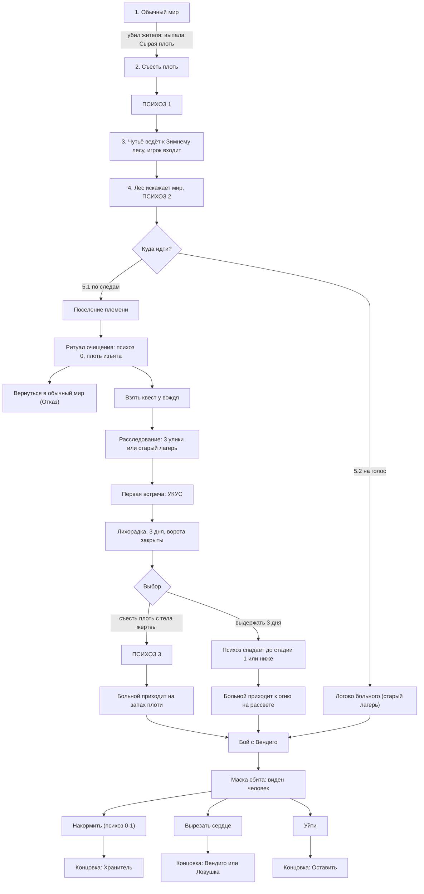

# Мод о мифических созданиях: Вендиго

Дизайн-документ первого существа мода. Версия Майнкрафта и платформа пока не важны: здесь описаны сюжет, правила и механики.

## Содержание

1. [Идея](#идея)
2. [Скрытый лор](#скрытый-лор)
3. [Мир: биом, поселение, персонажи](#мир-биом-поселение-персонажи)
4. [Правила: психоз, голод, лихорадка](#правила-психоз-голод-лихорадка)
5. [Сюжет](#сюжет)
6. [Укус: когда и как](#укус-когда-и-как)
7. [Улики](#улики)
8. [Бой с Вендиго](#бой-с-вендиго)
9. [Концовки](#концовки)
10. [Предметы](#предметы)
11. [Особые случаи](#особые-случаи)
12. [Порядок реализации](#порядок-реализации)
13. [Шаблон для других существ](#шаблон-для-других-существ)

---

## Идея

Игрок идёт убивать чудовище, а к финалу понимает, что Вендиго никогда не существовал. Это болезнь голода: человек, доведённый зимой до каннибализма. Рогатый силуэт, шёпот и «когти» — галлюцинации. Миф о духе убивает людей надёжнее, чем сама болезнь.

- **Игроку ничего не объясняют.** Он сам собирает улики, сам заболевает и сам проходит ломку. Правда открывается через его опыт, а не через текст.
- **Два взгляда на одно и то же.** Племя искренне верит в духа и действует из этой веры: изгоняет укушенных и охотится на собственных больных. Игрок единственный, кто может сложить картину целиком.
- **Мета-слой.** В обычном Майнкрафте жителей убивают без последствий. Мод делает первое убийство жителя грехом, с которого всё начинается.
- **Тон.** Тихий и холодный, без прыжков из-за угла. Страх строится на неопределённости: что из увиденного реально, а что нет.

## Скрытый лор

Игрок узнаёт эту историю по кускам, а племя не знает её вообще: за века она превратилась в миф.

1. Много поколений назад, в голодную зиму, группа охотников племени ушла в лес за стадом. Они носили охотничьи маски из оленьих черепов: так подкрадываются к животным, и по обряду это просьба к зверю отдать себя. В челюсть маски вставляли зубы предков-охотников на удачу.
2. Началась метель, группа осталась отрезанной, еда закончилась.
3. Один из охотников первым съел погибшего товарища. С этого началась болезнь: тяга к мясу, лихорадка, галлюцинации.
4. Остальные погибли или вернулись, не рассказав правды. Больной ушёл в лес в маске и вскоре умер, как умирает любой больной.
5. Издалека его видели только как силуэт с рогами. Так родился миф о духе Вендиго. Человек давно мёртв, а миф остался.
6. С тех пор болезнь возвращалась снова и снова: раз в несколько десятилетий кто-то голодал, съедал мёртвого и заболевал. Каждого такого человека племя принимало за очередного духа, убивало или изгоняло, а болезнь тем временем передавалась укусом.

**Нынешний больной.** Обычный охотник племени, пропавший этой осенью. Болезнь убивает за недели, поэтому долго он не проживёт: миф стар, а человек нет. Он выживает тем, что ест тех, кого убивает. Маску он нашёл в старом лагере погибших охотников, который племя считает проклятым местом.

**Главное правило мира.** Болезнь питается плотью. Без плоти и в тепле лихорадка спадает. Это не проклятие, и именно это игрок доказывает собственным телом.

## Мир: биом, поселение, персонажи

Племя настоящее, галлюцинацией является только сам Вендиго. Отдельного измерения нет: это новый биом (или существующая тайга/заснеженный лес с изменённой генерацией), который становится страннее по мере продвижения вглубь.

**Биом «Зимний лес».** Постоянный снегопад, плотный туман, приглушённые звуки, мало света. Обычная еда насыщает хуже, чем в других биомах («голодная зима»). Биом делится на внешнее кольцо и глубину: чем глубже, тем сильнее давит атмосфера.

**Поселение племени.** Круглое поселение прямо в лесу, без скал и укрытий. Вокруг частокол из плотно поставленных заострённых кольев с одними воротами и дозорными. Внутри длинные дома и навесы из коры и циновок, а в центре общий костёр, где собирается племя и проходит ритуал очищения. Оно не спрятано, а затеряно в чаще: туман и деревья скрывают его, пока игрок не подойдёт вплотную.

**Старый лагерь охотников.** Брошенный лагерь глубоко в лесу: кости, посуда, остатки костра, дневник и ледяное зеркало. Племя запрещает туда ходить: «там дух взял первых». Сейчас там логово больного.

| Персонаж | Роль | Во что верит |
| --- | --- | --- |
| Вождь | Выдаёт главный квест «убить Вендиго» | Дух реален, его нужно истребить, пока он не забрал людей |
| Шаман | Проводит ритуал очищения, объясняет улики через миф | Дух принимает облик того, кем питается, носит чужое лицо |
| Охотники | Ходят в лес «убивать духа», дают подсказки по следам | Укушенный уже проклят, медлить нельзя |
| Больной | Тот, кого игрок считает Вендиго | Для себя он человек, который хочет есть и мёрзнет |

**Во что верит племя.** Вендиго для них дух зимнего голода, который приходит в метели и «вселяется» в тех, кого коснулся. Это не ложь и не прикрытие, и поэтому оно опасно: укушенного считают проклятым и изгоняют, больного загоняют вглубь леса, а охотники каждый раз празднуют «победу над монстром».

Племя различает два состояния:
- **«Тронутый духом».** Человек слышит шёпот и видит тени, но не укушен. Его ещё можно очистить ритуалом.
- **«Захваченный».** Человек укушен. Племя считает его потерянным и закрывает перед ним ворота.

## Правила: психоз, голод, лихорадка

Всё держится на одной шкале **Психоз** от 0 до 100. Числа ниже стартовые, их настраивают при тестировании.

| Стадия | Порог | Что видит и чувствует игрок |
| --- | --- | --- |
| 0 | 0–19 | Мир обычный |
| 1 | 20–49 | Шёпот на краю слуха, звери выглядят чуть неправильно |
| 2 | 50–84 | Рогатый силуэт на краю экрана, деревья как рога, голос зовёт |
| 3 | 85–100 | Жители выглядят как мясо, говорить с ними нельзя, интерфейс искажается, голод падает быстрее |

| Что меняет психоз | Значение |
| --- | --- |
| Съесть сырую плоть | +30. Если игрок укушен, сразу стадия 3 |
| Укус | Не ниже 50 (стадия 2) + лихорадка |
| Зимний лес (без плоти и укуса) | Медленно растёт, но не выше стадии 1 |
| Ношение Маски Вендиго | +2 в минуту |
| Тепло (костёр, очаг поселения) | −2 в минуту |
| Горячая еда | −5 за порцию |
| Ритуал очищения | Сброс до 0 |

**Голод.** В Зимнем лесу обычная еда восстанавливает меньше насыщения, а сырая плоть восстанавливает много и сразу. Это давление, а не наказание: игрок сам решает, поддаться или нет.

**Лихорадка.** Эффект, который запускает только укус (см. [Укус](#укус-когда-и-как)). Пока она длится: игрок не может спать (кровать не пропускает ночь), экран дрожит сильнее ночью, голод падает быстрее, а тяга к плоти нарастает: «Чутьё» подсказывает, где лежат тела жертв больного.

**Правило честности.** Галлюцинации только клиентские: они меняют то, что игрок видит и слышит, но не реальные объекты, урон и структуры. Игрок может ошибиться, но мод не наказывает его за то, чего нет.

| Реально | Галлюцинация |
| --- | --- |
| Племя, поселение, больной, укусы, голод, следы, старый лагерь, маска | Рогатый силуэт, шёпот, «когти», «мясные» жители |

Психоз при этом может ограничивать действия игрока открыто: на стадии 2–3 игрок не может дать еду больному, и мод пишет «Руки не слушаются». Это эффект болезни, а не подмена предметов.

## Сюжет

### Акт 1. Обычный мир
Игрок живёт как в обычном Майнкрафте. Сюжет стартует, когда он убивает жителя: с тела выпадает **«Сырая плоть»** без всякого предупреждения. Мод включает голодную зиму. Если игрок никогда не убивает жителей, история не начинается: это сознательный выбор, а не дыра.

### Акт 2. Съесть плоть
Игрок голодает и может съесть плоть. Это добровольный выбор, мод никогда не говорит, что он обязан. Первое поедание даёт **Психоз 1**: шёпот, звери выглядят «неправильно», обычная еда почти не насыщает.

### Акт 3. Зимний лес
Ночью игрок видит сон: следы в снегу ведут к заснеженному биому. После этого в интерфейсе появляется **«Чутьё»**: слабая подсказка направления на биом (работает только на стадии 1 и выше). Игрок идёт по ней и входит в лес.

### Акт 4. Лес искажает мир
Это не телепорт, а нарастающий бред: деревья как рога, белеющий туман, голос зовёт. Игрок получает **Психоз 2**.

### Акт 5. Развилка: куда идти
Голос зовёт в одну сторону, следы ведут в другую. Это главный выбор игры.

**5.1. По следам (путь расследования)**
1. Следы приводят к воротам поселения. Шаман видит, что игрок «тронут духом», и впускает его.
2. Ритуал очищения у центрального костра: психоз сбрасывается до 0, сырая плоть из рюкзака изымается.
3. Выбор: вернуться в обычный мир (концовка **Отказ**) или взять квест у вождя. Отказ не закрывает историю: к вождю можно вернуться позже.
4. Квест: найти и убить Вендиго. Игрок получает журнал охотника и ищет улики.
5. Когда выполнено условие первой встречи (см. ниже), больной кусает игрока.
6. Три дня лихорадки: ворота поселения закрыты, игрок один в лесу.
7. Выбор: съесть плоть с тела жертвы или выдержать три дня.
8. Бой с Вендиго (см. раздел ниже).

**5.2. На голос (ловушка)**
Игрок идёт на голос, не заходя в поселение. Голос приводит его в старый лагерь, где ждёт больной. Укуса здесь нет, ритуала не было, психоз остаётся на стадии 2, поэтому игрок видит монстра. Сразу начинается бой.

## Укус: когда и как

Укус — ключевая точка сюжета. Он происходит **один раз, по сценарию, на пути 5.1.**

**Когда.** Игрок взял квест вождя и находится в глубине леса. Укус срабатывает ночью, как только выполнено одно из условий:
- найдено 3 улики (любые);
- игрок дошёл до старого лагеря охотников.

Если условие выполнено днём, укус срабатывает в первую же ночь.

**Как проходит сцена.** Начинается метель, видимость почти нулевая. Игрок слышит шаги, из темноты выходит рогатый силуэт, вцепляется в плечо и кусает. Игрок может ударить, но урон не проходит. После одного укуса больной, слабый и голодный, отступает в темноту. Укус не может убить игрока: здоровье не падает ниже двух сердец.

**Что даёт укус.**
1. Эффект **«Лихорадка»** на три игровых дня (правила в разделе [Правила](#правила-психоз-голод-лихорадка)).
2. Психоз поднимается до стадии 2.
3. Поселение закрывается: дозорные не пускают, шаман говорит, что «дух коснулся тебя». Племя считает игрока захваченным.
4. Плоть никто не подкладывает: она уже есть в мире. В лесу с самого начала лежат тела охотников, убитых больным (те самые жертвы со следами человеческих зубов, которые служат уликами). Теперь они ещё и единственная еда в округе, а «Чутьё» делает их запах невыносимо явным.
5. В журнале появляется запись «Собственный укус»: при осмотре раны видны следы человеческих зубов. Игрок сам понимает, что дух кусать не может.

**Три дня лихорадки.**

| День | Что происходит |
| --- | --- |
| День 1 | Лихорадка сильнее всего ночью. Игрок один, еды нет, кроме коры, лишайника и вываренной кожи |
| День 2 | Тяга к плоти нарастает, тела жертв ощущаются через «Чутьё». Костёр временно снижает психоз |
| Рассвет дня 3 | Если игрок не ел плоть, психоз падает до стадии 1 или ниже, лихорадка отпускает |

**Выбор.** Игрок может взять плоть с тела жертвы и съесть её в любой момент трёх дней: лихорадка мгновенно отпускает, но психоз встаёт на стадию 3. Это путь к Вендиго. Если он выдерживает все три дня, это путь к Хранителю.

**Появление больного.**
- Если игрок выдержал, больной выходит к его костру на рассвете дня 3, привлечённый теплом. Игрок видит человека в маске.
- Если игрок съел плоть, больной приходит на запах сразу. Игрок видит монстра.

Укус больше нигде не повторяется. В бою больной наносит обычный урон.

## Улики

Правда открывается не через реплику, а через то, как племя обходит каждую улику. Игрок видит доказательство, а шаман вписывает его в миф. Игрок понимает истину именно потому, что видит эту подгонку.

| Улика | Где находится | Что видит игрок | Как объясняет шаман |
| --- | --- | --- | --- |
| Следы зубов на телах | Жертвы в лесу и в лагере | Ровная дуга резцов, человеческий прикус, не звериный | «Дух принимает облик того, кем питается. Он носит чужое лицо» |
| Босые следы | Снег вокруг мест нападений | Отпечатки исхудавших ног в обмотках, не лап | «Дух ступает как человек, чтобы обмануть охотников» |
| Старый лагерь | Глубина леса | Кости, посуда, остатки костра | «Это место, где дух взял первых. Не ходи туда» |
| Дневник охотника | Старый лагерь | Запись о голоде, о первом съеденном товарище, о нарастающей лихорадке | «Дух шептал им через бумагу. Не верь написанному» |
| Маска | У больного | Охотничий череп с человеческими зубами | «Дух надел череп, как мы надеваем шкуры» |
| Ледяное зеркало | Старый лагерь | При взгляде галлюцинация исчезает, виден тощий человек | «Лёд лжёт. Он показывает то, что ты хочешь увидеть» |
| Собственный укус | Рана игрока (после укуса) | Следы человеческих зубов | «Дух кусает чужими зубами» |

**Журнал охотника.** Ведётся автоматически: каждая находка получает запись, а следы зубов можно сопоставить с зубами маски. Когда набирается три-четыре улики, объяснения шамана начинают звучать натянуто, и игрок понимает, что вера мешает племени видеть.

**Ледяное зеркало.** Работает только внутри Зимнего леса: за его пределами лёд тает. Это единственный предмет, который прямо показывает правду.

## Бой с Вендиго

Бой строится вокруг одного момента: игрок сбивает маску и видит человека. Сюда приводят и путь по следам, и путь на голос.

### Фаза 1: рогатый Вендиго
Он быстрый и опасный, вокруг тени и шёпот, маска выглядит как часть его головы. Тело неуязвимо, пока маска на нём (урон не проходит), бить нужно по маске: у неё своя прочность. Галлюцинации здесь на пике.

### Фаза 2: человек
Когда маска слетает, шёпот и тени обрываются. Под ней измученный человек: запавшие глаза, кожа прилегает к костям, лохмотья, в руке кость. Он медленный, пытается ползти и бормочет человеческое: «холодно», «есть», имена. Он может ударить, если подойти вплотную, поэтому напряжение остаётся. Но победа здесь не вопрос силы: фаза тяжёлая морально, а не по сложности, и игрок не должен её пролистывать.

### Короткий бой истинного пути
Игрок выдержал три дня и видит человека в маске с самого начала. Больной бросается от голода. Достаточно сбить маску и остановить его, добивать не нужно.

### Три исхода

| Действие | Условие | Что происходит | К какой концовке ведёт |
| --- | --- | --- | --- |
| Накормить | Психоз 0–1, есть горячий отвар | Игрок даёт еду, больной засыпает | Хранитель |
| Вырезать сердце | Всегда | Долгое действие с удержанием кнопки, неприятные звуки, никакой награды в этот момент | Вендиго или Ловушка |
| Уйти | Всегда | Игрок оставляет его в лесу | Оставить |

Горячий отвар игрок варит из коры и лишайника: это единственная еда на третий день, и одна порция остаётся для больного. Если психоз на стадии 2–3, вариант «накормить» показывается, но блокируется: «Руки не слушаются». Так выбор честный: в плохих концовках игрок не может сказать, что не знал, но и не может поступить иначе.

Если игрок при ясном рассудке (психоз 0–1) всё равно вырезает сердце, это самая тяжёлая версия: он знает, что делает.

## Концовки

| Концовка | Как к ней прийти | Что получает игрок | Смысл |
| --- | --- | --- | --- |
| Хранитель (истинная) | По следам, укус, выдержать три дня, накормить | Маска Хранителя, Очаг памяти | Болезнь можно пережить, монстра не было |
| Отказ | По следам, ритуал очищения, вернуться в обычный мир | Психоз сброшен, история не раскрыта | Игрок ушёл, не узнав правды |
| Оставить | Выбрать «уйти» после боя | Ничего | Племя позже убивает больного как «духа», миф побеждает |
| Вендиго | По следам, укус, съесть плоть, вырезать сердце | Маска Вендиго, Сердце Вендиго | Игрок стал тем, от кого бежал |
| Ловушка | На голос, вырезать сердце | Маска Вендиго, Сердце Вендиго | Победа выглядит как триумф, но это повторение того, что делало племя |

### Хранитель
Игрок выдерживает три дня и видит больного таким, какой он есть: исхудавший человек в обносках с черепом оленя на голове. Бой короткий: игрок сбивает маску, не добивает, а кормит больного отваром. Больной засыпает, а маска достаётся игроку не как трофей, а как то, что осталось от человека, которого он спас.

Игрок возвращается к поселению. Племя не принимает правду сразу, и финал горький:
- Шаман видит выжившего укушенного и спящего человека, берёт больного к себе тайком от вождя.
- Вождь не может отказаться от веры. Племя расколото: часть видит правду, часть нет. Когда болезнь вернётся, охота «на духа» может начаться снова.
- Игрок получает Очаг памяти, а Зимний лес становится тише: психоз в нём больше не растёт.

### Вендиго и Ловушка
Игрок сбивает маску, видит измученного человека и всё равно вырезает сердце, а маску забирает как трофей. Психоз 3: жители выглядят как мясо, говорить с ними нельзя. Племя празднует: это то же, что оно делало годами. Игрок встал в один ряд с ними.

На пути Ловушки игрок ещё и не знает, что происходит: он пошёл на голос и «победил монстра».

### Финальный удар лора
После «победы» игрок получает **Сердце Вендиго**. Правда в его описании проступает по частям за несколько игровых дней: «тёплое», потом «слишком похоже на человеческое», в конце «человеческое сердце». Маска так же из «Маски Вендиго» превращается в «охотничью маску». Галлюцинации стихают по мере того, как предметы раскрываются. Это и есть вывод: монстр — болезнь, а не существо.

## Предметы

Маска служит геймплею, Сердце служит истории.

**Маска: откуда она.** Это не лут с босса, а охотничья маска из оленьего черепа, очень старая. Её носили заболевшие охотники прошлых вспышек, нынешний больной нашёл её в брошенном лагере. Зубы в ней человеческие: по обряду так оберегали охотника. В бою маска слетает с головы больного и падает на землю, и игрок поднимает её после выбора. Одна и та же маска, разные свойства: они зависят от того, что игрок сделал.

| Предмет | Как получить | Ночное зрение | Цена |
| --- | --- | --- | --- |
| Маска Хранителя | Концовка Хранитель | Чистое: живые существа светятся теплом, остальное видно слабо | Нет. Зубы со временем стираются в описании предмета |
| Маска Вендиго | Вендиго или Ловушка, снята с больного после боя | Мощнее: видно далеко, жители светятся как добыча | Психоз растёт, пока маска надета, голод падает быстрее |

| Предмет | Роль |
| --- | --- |
| Сырая плоть | Выпадает с убитого жителя, запускает сюжет. Описание нейтральное, без предупреждения |
| Журнал охотника | Автоматически собирает улики, позволяет сопоставить следы зубов с маской |
| Ледяное зеркало | Показывает человека вместо галлюцинации. Работает только внутри Зимнего леса |
| Горячий отвар | Варится из коры и лишайника. Снижает психоз, нужен для варианта «накормить» |
| Сердце Вендиго | Трофей плохих концовок. Описание за несколько игровых дней проступает как правда |
| Очаг памяти | Награда Хранителя: защищает от галлюцинаций, напоминает, что сделал голод |

## Особые случаи

| Случай | Что происходит |
| --- | --- |
| Игрок не убивает жителей | Сюжет не стартует. Это нормально |
| Игрок убивает жителей снова | Плоть выпадает снова, психоз можно повысить |